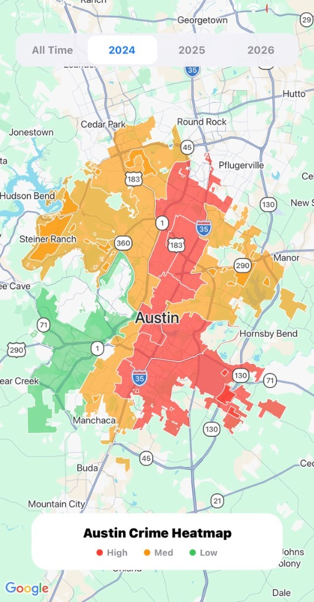

# 🚔 Austin Crime Blotter & Council District Analytics Platform

<p align="center">
  
</p>
<p align="center"><em>Live Council District Heatmap with Temporal Breakdown (Low / Med / High Crime Volume)</em></p>

[](https://python.org)
[](https://expo.dev)
[](https://developers.google.com/sheets)
[](https://data.austintexas.gov)
[](#)

An end-to-end civic data engineering and analytics solution that bridges raw municipal open data from the City of Austin with an interactive mobile/web geospatial heatmap. Combines an automated Python Socrata data harvester with an Expo-powered React Native visualization client.

---

## 🏛️ System Architecture

```
                  +----------------------------------------------+
                  |         City of Austin Open Data API         |
                  |     (Socrata REST API: fdj4-gpfu.json)       |
                  +-----------------------+----------------------+
                                          |
                                          | HTTPS JSON ($limit=5000)
                                          v
                  +----------------------------------------------+
                  |         Harvester Pipeline (Python)          |
                  |             `crime_harvester.py`             |
                  |     - Normalizes timestamp & crime types     |
                  |     - District validation & deduplication    |
                  +-----------------------+----------------------+
                                          |
                                          | Google Service Account OAuth
                                          v
                  +----------------------------------------------+
                  |            Google Sheets Datastore           |
                  |         (Real-time Cloud CSV Bridge)         |
                  +-----------------------+----------------------+
                                          |
                                          | PapaParse Stream
                                          v
                  +----------------------------------------------+
                  |     CrimeDashboard Client (React Native)     |
                  |   - Polygon Mapping by Council District      |
                  |   - Incident Volume Color Coding (Heatmap)   |
                  |   - Longitudinal Filtering (2024-2026)       |
                  |   - Historical Drilldown Modals              |
                  +----------------------------------------------+
```

---

## 🚀 Key Modules

### 1. Ingestion Engine (`crime_harvester.py`)
- Automated extractor consuming real-time incident reports directly from the official Austin Police Department dataset.
- Filters, aggregates, and transforms incident dates, council districts, and offense codes.
- Streams structured datasets into a centralized Google Sheets repository via `gspread` and service account authentication.

### 2. Geospatial Dashboard (`CrimeDashboard/`)
- Built with **React Native** and **Expo SDK**.
- Maps out all 10 Austin City Council districts with precise polygon coordinates.
- Dynamically assigns color-coded severity heat levels (Low: Green, Medium: Orange, High: Red) based on incident volume per district.
- Provides multi-year temporal filtering (All Time, 2024, 2025, 2026).
- Interactive modals present top 3 crime type breakdowns and timestamped blotters per district.

---

## 🛠️ Setup & Running

### Data Harvester Pipeline
```bash
# Navigate to project root
cd PoliceReport

# Install Python requirements
pip install requests gspread oauth2client

# Ensure service_account.json is present with Google Drive / Sheets permissions
python3 crime_harvester.py
```

### Mobile / Web Dashboard
```bash
# Navigate to CrimeDashboard directory
cd PoliceReport/CrimeDashboard

# Install node dependencies
npm install

# Start the Expo development server
npx expo start
```

---

## 🔒 Security & Best Practices
- Private Google Service Account keys and OAuth tokens are strictly ignored by `.gitignore`.
- Raw datasets are streamed in batches to respect Socrata API rate limits.

